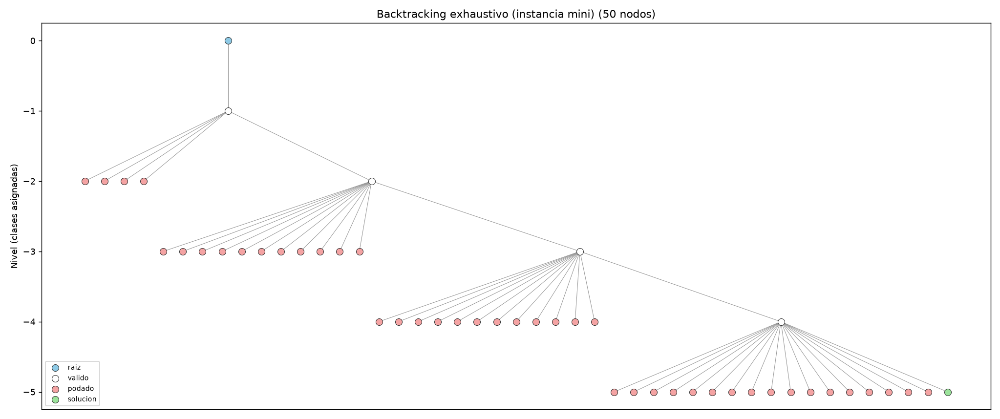

# Reporte final: Sistema experto para asignación de horarios escolares

> La definición formal del problema (entradas, estados, reglas y función objetivo) está en [problema.md](problema.md). Este reporte explica cómo se resolvió y qué se obtuvo.
> Los números de las tablas salen de `py -m src.main experimentos`. El archivo completo está en `resultados/reporte_experimentos.md`.

## 1. Arquitectura del sistema experto

| Componente | Archivo | Qué hace |
|---|---|---|
| Base de hechos | `src/modelos.py`, `data/*.json` | Materias, grupos, maestros, salones y bloques |
| Base de conocimiento | `src/reglas.py` | 6 reglas duras SI–ENTONCES (R1–R6), 6 reglas suaves (S1–S6) y la función objetivo |
| Motor de inferencia | `src/motor_inferencia.py` + algoritmos de búsqueda | Aplica las reglas para aceptar o podar cada asignación y diagnostica si el problema puede tener solución |
| Módulo de explicación | `motor_inferencia.explicar()` | Responde por qué una clase quedó en cierto bloque, salón y maestro, y por qué se descartaron las demás opciones |
| Aprendizaje | `src/aprendizaje.py` | Ajusta los pesos w1–w4 con la retroalimentación del usuario |
| Interfaz | `app.py` (Streamlit) y `src/main.py` (terminal) | Uso interactivo y experimentos |

## 2. Árbol de decisión

El sistema usa dos árboles:

**a) Árbol de estados de la búsqueda** (`src/arbol_decision.py`). La raíz es el horario vacío. Cada nivel corresponde a una clase asignada, y cada rama a una opción (bloque, salón, maestro). Las ramas que violan una regla dura se podan, y el sistema anota qué regla causó la poda. Se implementaron los recorridos **preorden** y **postorden** (DFS), **inorden** (versión para árboles con más de dos hijos) y **por niveles** (BFS).

*Blanco = estado válido, rojo = podado por una regla, verde = horario completo.* En `resultados/arbol_mrv.png` se ve el árbol de MRV para la misma instancia: es mucho más angosto, porque las opciones imposibles se descartan antes de entrar al árbol.

**b) Árbol de decisión de diagnóstico** (`motor_inferencia.construir_arbol_diagnostico()`). Antes de buscar, el sistema responde cinco preguntas SÍ/NO, ordenadas de la más barata de revisar a la más cara:

1. ¿Las horas de cada grupo caben en la semana?
2. ¿Cada clase tiene un salón del tipo y tamaño correctos?
3. ¿Alcanzan las horas de aulas y de laboratorios?
4. ¿Cada materia tiene al menos un maestro que la imparta?
5. ¿El **flujo máximo** cubre todas las horas de clase?

Si alguna respuesta es NO, el sistema llega a una hoja que dice la causa ("faltan laboratorios", "faltan horas de maestro") y no gasta tiempo en buscar. El diagrama está en `resultados/arbol_diagnostico.dot` y también se ve en la pestaña 2 de la interfaz.

## 3. Algoritmos

| Tipo | Algoritmo | Idea clave |
|---|---|---|
| Exhaustiva | Backtracking DFS (primera solución y óptimo) | Prueba todas las combinaciones bloque × salón × maestro en orden fijo y poda solo cuando una asignación viola una regla dura |
| Exhaustiva | BFS (óptimo) | Recorre el árbol nivel por nivel; encuentra el óptimo pero necesita mucha memoria |
| Heurística | MRV estático | Revisa R4 y R5 una sola vez al inicio y asigna primero la clase con menos opciones (merge sort) |
| Heurística | MRV + forward checking | Recalcula las opciones de cada clase pendiente y poda en cuanto alguna se queda sin opciones |
| Heurística + flujo | Flujo máximo + MRV | Edmonds-Karp decide primero qué maestro da cada materia, y el árbol solo decide bloque y salón |
| Heurística | Greedy | Elige siempre la opción más barata (quicksort por costo) y nunca regresa |
| Heurística | A\* con haz | f = g + h. h suma, para cada clase pendiente, su costo local mínimo; nunca sobreestima (es admisible). El haz limita la memoria |
| Búsqueda local | Ascenso de colina | Solo acepta cambios que mejoran el costo |
| Búsqueda local | Recocido simulado | A veces acepta cambios peores (con probabilidad e^(−Δ/T)) para salir de mínimos locales |

**Ordenamiento:** merge sort y quicksort se implementaron a mano (`src/ordenamiento.py`). Merge sort ordena las clases por dificultad (MRV); quicksort ordena los candidatos por costo.

**Teorema de flujo:** la red es FUENTE → (grupo, materia) → maestro → SUMIDERO. Las capacidades son las horas de cada materia y el máximo de horas de cada maestro. Por el teorema de flujo máximo y corte mínimo, si el flujo máximo es menor que el total de horas, **ningún** horario es posible, y los maestros saturados del corte mínimo señalan dónde está el cuello de botella.

## 4. Resultados: búsqueda exhaustiva vs. heurística

### Instancia mini (5 clases): la búsqueda exhaustiva sí termina

| Algoritmo | Costo | Nodos | Tiempo (s) |
|---|---|---|---|
| Exhaustiva DFS (óptimo) | **3.5** | 4 054 | 0.15 |
| Exhaustiva BFS (óptimo) | **3.5** | 4 054 (2 772 en memoria a la vez) | 0.13 |
| A\* | **3.5** | **31** | 0.02 |
| Recocido simulado | **3.5** | 4 016 vecinos | 0.29 |
| Ascenso de colina | 4.5 (mínimo local) | 3 527 vecinos | 0.27 |
| MRV / Greedy (primera solución) | 6.5 | 5 | < 0.01 |

**A\* llega al mismo óptimo que la búsqueda exhaustiva explorando 130 veces menos nodos.** El recocido también llega al óptimo; el ascenso de colina se queda atorado en un mínimo local en 4.5. Esto muestra por qué conviene aceptar a veces cambios peores.

### Instancia pequeña (10 clases, ~2.5 × 10¹⁴ combinaciones)

| Algoritmo | Costo | Nodos | Tiempo (s) |
|---|---|---|---|
| Exhaustiva DFS (óptimo) | 9.0 (no terminó) | 100 000 (límite) | 7.5 |
| Exhaustiva BFS (óptimo) | sin solución (se quedó sin memoria) | 200 000 (límite) | 2.3 |
| MRV + forward checking | 5.33 | 10 | < 0.01 |
| A\* (haz 100) | **4.33** | 1 654 | 8.9 |
| Recocido simulado | **4.33** | 3 670 vecinos | 0.40 |

### Instancia mediana (62 clases, semana completa)

| Algoritmo | ¿Solución? | Costo | Nodos | Tiempo (s) |
|---|---|---|---|---|
| Exhaustiva DFS | **no** | – | 10 000 (límite) | 18.2 |
| Exhaustiva BFS | **no** | – | 20 000 (límite) | 1.0 |
| Greedy | **no** (no regresa) | – | 8 | < 0.01 |
| MRV estático | sí | 70.43 | **62** | 0.02 |
| Flujo máximo + MRV + FC | sí | 69.43 | **62** | 0.26 |
| Recocido simulado | sí | **28.43** | 2 936 vecinos | 1.2 |

Con 62 clases, la búsqueda exhaustiva no encuentra ni un horario válido después de 10 000 nodos. **MRV encuentra uno sin tener que regresar ni una vez (62 nodos = 62 clases)**, y el recocido simulado lo mejora de 84 a 28 puntos de costo.

Gráficas: `resultados/comparacion_*.png` (nodos, tiempo y costo) y `resultados/recocido_*.png` (curva de mejora).

### Observaciones

- **Forward checking hace más verificaciones de reglas que MRV estático en estas instancias.** Revisa a cada paso las opciones de todas las clases pendientes. Su ventaja aparece cuando el problema obliga a regresar muchas veces; aquí MRV estático casi nunca tiene que regresar.
- **El ascenso de colina y el recocido empatan en el ejemplo mediano.** En varias pruebas con distintas semillas aleatorias quedaron entre 25 y 34 puntos los dos. La ventaja del recocido se ve con claridad en la instancia mini.
- **A\* puro no termina en la instancia pequeña.** La heurística es admisible pero optimista, y hay miles de estados empatados. Con el haz de 100 estados sí termina, aunque pierde la garantía de óptimo, y el programa lo avisa en sus notas.
- **El flujo máximo no minimiza el desbalance.** Le carga a un maestro todas las horas que puede dar, si eso cubre la demanda. Un flujo de costo mínimo resolvería esto; queda como mejora futura.

## 5. Simulación del aprendizaje

Un **usuario simulado** tiene preferencias ocultas: le importan mucho el balance de carga y las preferencias de los maestros (pesos 1, 0.5, 2.5, 3). El sistema empieza con los pesos de fábrica (3, 1, 0.5, 1). En cada ronda el usuario elige el mejor de dos horarios. Cuando el sistema habría elegido distinto, corrige sus pesos con una regla tipo perceptrón:

    w_i ← w_i + tasa · (rasgo_i(rechazado) − rasgo_i(aceptado))

Resultados en 40 rondas (`resultados/aprendizaje.png`):

- **Coincidencia con el usuario: 82 % → 91 %.**
- Pesos: (3.0, 1.0, 0.5, 1.0) → (2.0, 0.6, 1.2, 1.7). Se mueven hacia la preferencia real: baja el peso de los huecos y suben los de desbalance y preferencias.
- **El horario que genera el sistema con los pesos aprendidos le cuesta menos al usuario: 15.68 → 13.18.**

En la interfaz web (pestaña 6), un usuario real puede tomar el lugar del simulado eligiendo entre pares de horarios, y guardar los pesos aprendidos.

## 6. Limitaciones y trabajo futuro

- Los datos son ficticios; falta probar con el horario real de la escuela.
- Las clases son de 1 hora; no se manejan bloques dobles (por ejemplo, laboratorios de 2 horas seguidas).
- Flujo de costo mínimo para balancear la carga de los maestros.
- A\* con una heurística más informada, que considere la competencia entre clases por los mismos bloques.
