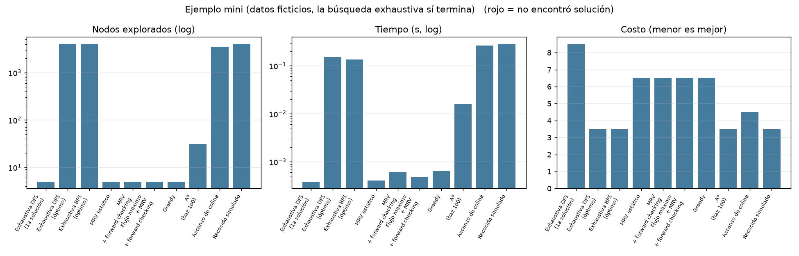
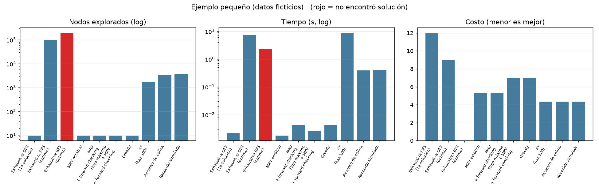
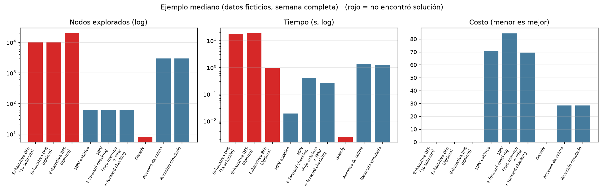
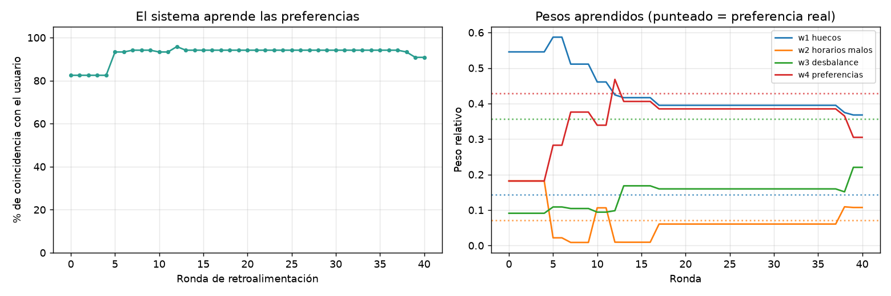

# Resultados de los experimentos

Generado con `py -m src.main experimentos`.

## Ejemplo mini (datos ficticios, la búsqueda exhaustiva sí termina)

Diagnóstico previo: **Posiblemente factible: ejecutar la búsqueda heurística.**

| algoritmo | solución | costo | nodos | verificaciones | tiempo (s) | exploró todo |
|---|---|---|---|---|---|---|
| Exhaustiva DFS (1a solución) | sí | 8.5 | 5 | 49 | 0.0004 | no |
| Exhaustiva DFS (óptimo) | sí | 3.5 | 4054 | 30792 | 0.1531 | sí |
| Exhaustiva BFS (óptimo) | sí | 3.5 | 4054 | 30792 | 0.1345 | sí |
| MRV estático | sí | 6.5 | 5 | 44 | 0.0004 | no |
| MRV + forward checking | sí | 6.5 | 5 | 144 | 0.0006 | no |
| Flujo máximo + MRV + forward checking | sí | 6.5 | 5 | 124 | 0.0005 | no |
| Greedy | sí | 6.5 | 5 | 44 | 0.0006 | no |
| A* (haz 100) | sí | 3.5 | 31 | 3808 | 0.0159 | no |
| Ascenso de colina | sí | 4.5 | 3527 | 26343 | 0.2661 | no |
| Recocido simulado | sí | 3.5 | 4016 | 26237 | 0.2867 | no |

## Ejemplo pequeño (datos ficticios)

Diagnóstico previo: **Posiblemente factible: ejecutar la búsqueda heurística.**

| algoritmo | solución | costo | nodos | verificaciones | tiempo (s) | exploró todo |
|---|---|---|---|---|---|---|
| Exhaustiva DFS (1a solución) | sí | 12.0 | 10 | 326 | 0.0022 | no |
| Exhaustiva DFS (óptimo) | sí | 9.0 | 100000 | 1575302 | 7.5174 | no |
| Exhaustiva BFS (óptimo) | no | - | 200000 | 1009779 | 2.3221 | no |
| MRV estático | sí | 5.33 | 10 | 220 | 0.0018 | no |
| MRV + forward checking | sí | 5.33 | 10 | 1346 | 0.0041 | no |
| Flujo máximo + MRV + forward checking | sí | 7.0 | 10 | 890 | 0.0026 | no |
| Greedy | sí | 7.0 | 10 | 220 | 0.0043 | no |
| A* (haz 100) | sí | 4.33 | 1654 | 2300350 | 8.8936 | no |
| Ascenso de colina | sí | 4.33 | 3543 | 60213 | 0.3926 | no |
| Recocido simulado | sí | 4.33 | 3670 | 59064 | 0.3989 | no |

## Ejemplo mediano (datos ficticios, semana completa)

Diagnóstico previo: **Posiblemente factible: ejecutar la búsqueda heurística.**

| algoritmo | solución | costo | nodos | verificaciones | tiempo (s) | exploró todo |
|---|---|---|---|---|---|---|
| Exhaustiva DFS (1a solución) | no | - | 10000 | 10459353 | 18.2176 | no |
| Exhaustiva DFS (óptimo) | no | - | 10000 | 10459353 | 19.0288 | no |
| Exhaustiva BFS (óptimo) | no | - | 20000 | 487376 | 0.9695 | no |
| MRV estático | sí | 70.43 | 62 | 3958 | 0.0188 | no |
| MRV + forward checking | sí | 84.43 | 62 | 157325 | 0.4022 | no |
| Flujo máximo + MRV + forward checking | sí | 69.43 | 62 | 98511 | 0.2633 | no |
| Greedy | no | - | 8 | 171 | 0.0025 | no |
| Ascenso de colina | sí | 28.43 | 2933 | 164304 | 1.3336 | no |
| Recocido simulado | sí | 28.43 | 2936 | 163327 | 1.2269 | no |

## Aprendizaje

Concordancia con el usuario: 82% -> 91%. Costo del horario según el usuario: 15.68 -> 13.18. Pesos: [3.0, 1.0, 0.5, 1.0] -> [2.0226, 0.5894, 1.2115, 1.6765] (preferencia oculta [1.0, 0.5, 2.5, 3.0]).

